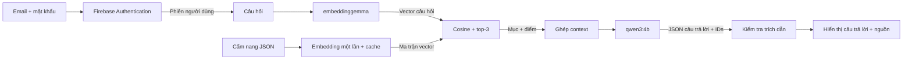

# Lumen Travel — Trợ lý du lịch TP. Hồ Chí Minh

**Trần Hải Thiên · MSSV 25127007 · Computational Thinking · Assignment 03**

Streamlit + Firebase Authentication + Ollama RAG. Cẩm nang 16 mục tiếng Việt, 12 địa điểm và 4 hướng dẫn thực tế. Câu trả lời hiển thị ID nguồn và top-3 mục theo cosine similarity. Khi cẩm nang thiếu thông tin, trợ lý trả lời không biết.

## Tình trạng bàn giao

- Mã nguồn, dữ liệu và kịch bản video đã có trong repo. **12/12 kiểm thử tự động đã đạt ngày 16/11/2026** trên Python 3.12, bao gồm Streamlit AppTest với Firebase giả lập; đây chưa phải xác nhận Firebase/mô hình thật.
- Cần cấu hình Firebase và xác minh đăng nhập thật bằng tài khoản của sinh viên.
- **6/6 câu hỏi chính đã đạt ngày 16/11/2026 qua Pinggy, embeddinggemma và qwen3:4b chạy CPU.** Codex đã đối chiếu câu trả lời với cẩm nang; sinh viên cần duyệt trước khi nộp. Bằng chứng: [kết quả thật](docs/evaluation-real.json).
- **Video:** CHƯA CÓ — sinh viên quay theo `docs/VIDEO_SCRIPT.md`, tải lên và thay dòng này bằng link xem được.
- **GitHub công khai:** https://github.com/comrange1104/lumen-travel-hcm-rag

## Cài đặt trên Windows

Dùng **Python 3.12** và PowerShell tại thư mục dự án:

```powershell
py -3.12 -m venv .venv
.\.venv\Scripts\python.exe -m pip install -r requirements.txt
if (-not (Test-Path -LiteralPath .env)) { Copy-Item .env.example .env }
```

Nếu đã có `.env`, giữ lại cấu hình đã điền. Hướng dẫn Firebase cho người mới: [Tạo Firebase từng bước](docs/FIREBASE_SETUP.md).

Cài Ollama từ https://ollama.com/download/windows hoặc:

```powershell
winget install --id Ollama.Ollama -e
ollama pull embeddinggemma
ollama pull qwen3:4b
```

Ứng dụng Ollama trên Windows thường tự chạy server. Kiểm tra `http://127.0.0.1:11434/api/tags`; nếu chưa có server, chạy `ollama serve` trong terminal riêng.

Tạo tunnel trong terminal riêng và giữ terminal mở:

```powershell
powershell -ExecutionPolicy Bypass -File scripts/start-pinggy.ps1
```

Chép URL HTTPS được cấp vào `OLLAMA_BASE_URL` trong `.env`. Điền `FIREBASE_API_KEY`, `FIREBASE_PROJECT_ID` từ Firebase Web config. Khởi động lại Streamlit sau khi đổi `.env`:

**Riêng máy GTX 1650 hiện tại:** đặt thêm `OLLAMA_NUM_GPU=0` trong `.env` để chạy CPU. Lần chạy thực tế đã gặp `CUDA error: shared object initialization failed` khi dùng CUDA; CPU chạy được nhưng có độ trễ cao hơn. Trên máy khác có thể để biến này trống để Ollama tự chọn GPU. Lần chẩn đoán T01 bằng CPU mất 44,74 giây, chưa tính bước tạo chỉ mục toàn cẩm nang.

```powershell
.\.venv\Scripts\streamlit.exe run app.py
```

Mở http://localhost:8501. Lệnh chuẩn của đề là `streamlit run app.py` khi môi trường ảo đã được kích hoạt. Đăng ký tài khoản rồi đăng nhập. Chỉ người đăng nhập mới được hỏi. Đăng xuất xóa lịch sử phiên; không có Firestore hay database.

Pinggy miễn phí có giới hạn phiên; URL thay đổi khi mở lại tunnel. Khi mất kết nối, mở tunnel mới, cập nhật `.env` và khởi động lại app. Script tạo khóa SSH riêng trong `tmp/` (đã được Git bỏ qua) để tránh lời nhắc mật khẩu, và dùng `u:Host:localhost:11434` để Ollama nhận đúng Host header. Thiếu tùy chọn này đã gây HTTP 403 trong lần kiểm tra thực tế và đã được sửa. Đối chiếu [hướng dẫn chính thức cho Ollama](https://pinggy.io/quickstart/ollama-api/).

## Kiến trúc và Computational Thinking



**Abstraction:** giữ `id`, `title`, `text`, `source`; địa điểm thêm `category`, `tags`. Không lấy dữ kiện ngoài cẩm nang để tự bổ sung đáp án.

**Decomposition:** giao diện gọi lớp xác thực và lớp RAG độc lập. RAG trả `AnswerResult(answer, source_ids, retrieved_entries, status)`. Lỗi kết nối được báo riêng, không lưu thành đáp án du lịch.

**Pattern recognition:** dùng lại Streamlit/session/Firebase REST từ Lab 3; Ollama/embedding/RAG từ Lab 4. Mẫu filter → score → top-k: kiểm tra các mục hợp lệ → cosine → ba mục tốt nhất. RAG-Rec có thể tái dùng bằng cách lọc category/tags trước khi chấm điểm địa điểm.

**Algorithm design:**

```text
nếu chưa đăng nhập: hiển thị đăng nhập và dừng
nếu câu hỏi rỗng: thông báo và dừng
nạp chỉ mục cẩm nang đã cache theo nội dung, URL và mô hình
vector_q = embeddinggemma(câu hỏi)
mục = top_3(cosine(vector_q, ma_trận_cẩm_nang))
phản_hồi = qwen3:4b(câu hỏi, context=mục, chỉ dùng context)
nếu phản_hồi báo thiếu dữ kiện: trả câu không biết cố định
nếu danh sách ID thiếu, không khớp hoặc ngoài mục đã truy xuất: từ chối đáp án
nếu danh sách ID hợp lệ nhưng văn bản thiếu dấu trích dẫn: thêm [Gxx] từ danh sách
ngược lại: hiển thị đáp án, IDs, ba mục và điểm
lưu hội thoại trong session hiện tại
```

Chọn **k = 3** để context ngắn, phù hợp máy GPU 4 GB. Không đặt ngưỡng cosine tùy ý: điểm cao thể hiện gần chủ đề, không chứng minh có đáp án. Câu hỏi giờ mở cửa G10 có thể truy xuất đúng bảo tàng nhưng vẫn phải trả lời không biết.

Embedding toàn cẩm nang dùng `st.cache_resource`; khóa cache chứa nội dung JSON, URL và mô hình. Embedding câu hỏi được tính mới. Các tác vụ mô hình chạy tuần tự, `keep_alive=0`, thinking tắt. Context ban đầu 4096 token, thử lại 2048 khi server báo lỗi tài nguyên. Lịch sử chỉ dùng để hiển thị, không dùng như nguồn dữ kiện.

## Dữ liệu và nguồn

Đối chiếu nguồn ngày **16/11/2026**. Nội dung được diễn đạt lại ngắn gọn từ cổng du lịch quốc gia; **sinh viên cần duyệt và chỉnh sửa trước khi nộp**. Các trang nguồn có thể chứa giá/giờ cũ, vì vậy bộ dữ liệu này chủ động chưa đưa giá vé hay giờ mở cửa vào. Link nguồn nằm trong từng mục JSON.

- G01–G05, G07: [7 must-see attractions](https://vietnam.travel/things-to-do/7-must-see-attractions-hcmc/).
- G06: [The perfect weekend in HCMC](https://vietnam.travel/things-to-do/ho-chi-minh-city-itinerary/).
- G08–G10: [10 tourist spots](https://vietnam.travel/things-to-do/10-tourist-spots-not-be-missed-ho-chi-minh-city/).
- G11–G14, G16: [Ho Chi Minh City](https://vietnam.travel/place-to-go/southeastern-vietnam/ho-chi-minh-city/).
- G15: [Vietnamese etiquette](https://vietnam.travel/things-to-do/vietnamese-etiquette-travellers/).

## Kiểm thử

```powershell
.\.venv\Scripts\python.exe -m unittest discover -s tests -v
.\.venv\Scripts\python.exe scripts/evaluate.py
```

Lệnh đầu kiểm tra dữ liệu, cosine, trích dẫn, câu hỏi trống và cache với mô hình giả lập. Lệnh sau gọi mô hình thật qua URL trong `.env`, ghi `output/evaluation.json`. Kết quả tự động dựa trên từ khóa chỉ là bước sàng lọc; người đọc phải kiểm chứng đáp án với nguồn trước khi kết luận đúng.

| Test | Câu hỏi | ID kỳ vọng | ID thực tế | Đúng/sai | Bước lỗi |
|---|---|---|---|---|---|
| T01 | Dinh Độc Lập do ai thiết kế? | G02 | G02, G10, G06 | Đạt | — |
| T02 | Bảo tàng Mỹ thuật TP.HCM trưng bày những gì? | G10 | G10, G09, G03 | Đạt | — |
| T03 | TP.HCM thường có mưa vào những tháng nào? | G14 | G14, G15, G09 | Đạt | — |
| T04 | Ai là kiến trúc sư thiết kế công trình Dinh Độc Lập? | G02 | G02, G10, G06 | Đạt | — |
| T05 | Giá vé máy bay từ TP.HCM đi Tokyo ngày mai là bao nhiêu? | Không có; phải nói không biết | G13, G15, G14 | Đạt | — |
| T06 | Bảo tàng Mỹ thuật TP.HCM mở cửa lúc mấy giờ vào Chủ nhật? | Không có dữ kiện giờ; phải nói không biết | G10, G09, G15 | Đạt | — |

Đo trên máy hiện tại, CPU qua Pinggy: sáu câu mất từ 30.95 đến 78.9 giây/câu, trung vị 44.73 giây. Thời gian này chưa bao gồm tạo chỉ mục ban đầu. Có thể cắt gọn đoạn chờ khi quay video và ghi chú rõ. Xem [lỗi thực tế và cách sửa](docs/FAILURE_ANALYSIS.md).

Khi sai: phân loại **missing data**, **retrieval**, **generation**; lỗi hạ tầng ghi riêng. Lưu cả kết quả lỗi trước khi sửa để giải thích trong video.

**Kiểm thử mở rộng E01:** yêu cầu liệt kê bốn bảo tàng trong cẩm nang, nhưng top-3 chỉ lấy G03, G09, G10 và thiếu G08. Mô hình trả lời không biết; chưa đạt yêu cầu liệt kê đủ bốn. Phân loại **retrieval**, 79,67 giây. Đây là giới hạn đã công bố, không nằm trong sáu câu hỏi chính. Có thể chạy lại riêng bằng `python scripts/evaluate.py --cases exploratory_cases.json --output output/exploratory.json`.

Kiểm tra thủ công cần thực hiện với Firebase thật:

- [ ] Đăng ký và đăng nhập thành công; sai mật khẩu báo lỗi.
- [ ] Chưa đăng nhập không thấy chat.
- [ ] Đăng xuất và đăng nhập lại không còn lịch sử.
- [ ] Hai phiên trình duyệt với hai tài khoản không chia sẻ lịch sử.
- [ ] Ngắt Ollama/Pinggy có thông báo lỗi và có thể hỏi lại khi kết nối phục hồi.
- [ ] Hai câu hỏi liên tiếp không embedding lại cả cẩm nang.
- [ ] Chạy được từ checkout mới theo README.

## Hạn chế và AI disclosure

- Cẩm nang nhỏ và tĩnh; không có giá vé, giờ mở cửa, giá chuyến bay hoặc dự báo trực tiếp.
- Câu hỏi tiếp nối như “ở đó thì sao?” chưa được giải nghĩa từ lịch sử.
- Câu hỏi tổng hợp cần hơn ba mục có thể bị từ chối vì context thiếu mục; E01 đã ghi nhận giới hạn này.
- Mô hình có thể hiểu sai context dù trích dẫn đúng ID. Kiểm tra trích dẫn không thay thế việc kiểm chứng nội dung.
- Độ trễ phụ thuộc GPU 4 GB, RAM 8 GB, tải mô hình và kết nối Pinggy. Lần đầu có chi phí tạo chỉ mục.
- Cache bị xóa khi khởi động lại server; lịch sử bị xóa khi phiên kết thúc hoặc đăng xuất.
- Đã sử dụng **OpenAI Codex** để hỗ trợ lập kế hoạch, viết code, soạn nháp dữ liệu, kiểm thử và tài liệu. Sinh viên chịu trách nhiệm duyệt nội dung và giải thích giải pháp.

## Checklist nộp bài

- [ ] Duyệt dữ liệu và README; điền kết quả kiểm thử thực tế.
- [x] Tạo repository GitHub **Public** và đẩy source lên; `.env` được Git bỏ qua.
- [ ] Quay video theo [kịch bản](docs/VIDEO_SCRIPT.md), dưới 5 phút.
- [ ] Thêm link video, kiểm tra quyền xem bằng cửa sổ ẩn danh.
- [ ] Kiểm tra lại repo public và hướng dẫn cài đặt từ đầu.

Không nộp khóa riêng, mật khẩu, `.env` hoặc token tài khoản. Tệp `.env.example` chỉ chứa các biến trống.
