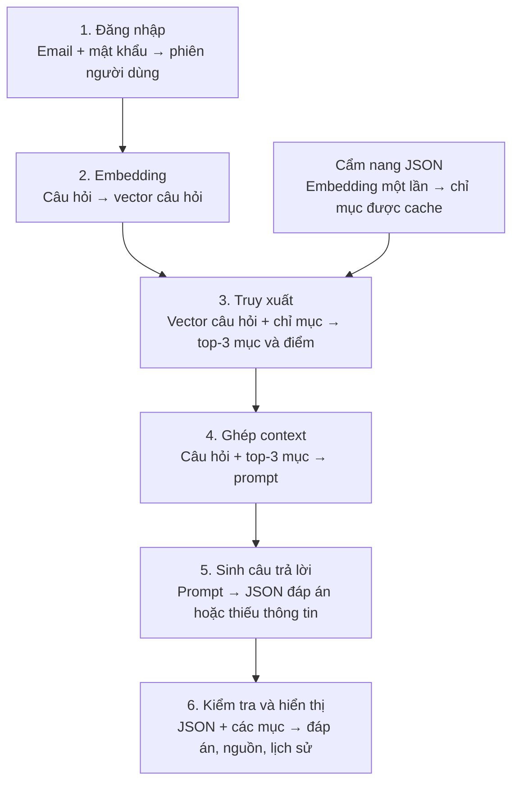

# Lumen Travel — Trần Hải Thiên · 25127007

Tài liệu hiển thị trong video. Kết quả lấy từ lần chạy được lưu ngày 16/11/2026, không cập nhật tự động.

## Abstraction

**Input:** câu hỏi du lịch TP.HCM của người đã đăng nhập.

**Output:** câu trả lời có trích dẫn hoặc thông báo thiếu thông tin; các mục truy xuất và điểm cosine.

**Cẩm nang:** 16 mục = 12 địa điểm + 4 hướng dẫn thực tế.

| Trường | Vai trò |
|---|---|
| `id` | Định danh, ví dụ G02, để trích dẫn |
| `title`, `text` | Nội dung để embedding và trả lời |
| `source` | URL tham khảo để đối chiếu |
| `category`, `tags` | Phân loại địa điểm, chuẩn bị cho RAG-Rec |

## Decomposition



## Pattern recognition

| Nguồn tái sử dụng | Áp dụng |
|---|---|
| Lab 3 | Streamlit, Firebase Authentication, st.session_state |
| Lab 4 | Ollama + Pinggy, embedding, RAG |

**Mẫu:** filter → score → top-k.

- **Hiện tại:** kiểm tra định dạng cẩm nang → chấm cosine toàn bộ 16 mục → chọn top-3.
- **RAG-Rec tiếp theo:** có thể lọc category/tags → chấm điểm phù hợp → chọn địa điểm tốt nhất.
- Bản hiện tại **chưa có bộ lọc địa điểm theo sở thích**.

## Algorithm design

```text
ANSWER(question, session):
    nếu chưa đăng nhập: dừng ở trang đăng nhập
    nếu question rỗng: thông báo lỗi
    index ← lấy chỉ mục cẩm nang đã cache
    q_vector ← embeddinggemma(question)
    scores ← cosine(q_vector, index.vectors)
    entries ← top_3(scores)
    context ← ghép question và entries
    result ← qwen3:4b(context, chỉ dùng dữ kiện trong context)
    nếu result báo thiếu dữ kiện: trả câu không biết
    kiểm tra ID trích dẫn thuộc entries
    nếu ID không hợp lệ: từ chối đáp án
    nếu văn bản thiếu [Gxx]: thêm từ danh sách ID hợp lệ
    hiển thị câu trả lời + entries + scores
    lưu hội thoại trong session; xóa khi đăng xuất
```

**Thiết kế:** k = 3 để context gọn và giảm nhu cầu bộ nhớ.

**Ví dụ:** hỏi người thiết kế Dinh Độc Lập cần G02; hỏi bốn bảo tàng có thể cần hơn ba mục.

## Kết quả kiểm thử

**6/6 câu hỏi chính đạt trong lần chạy đã lưu**, dùng embeddinggemma và qwen3:4b qua Pinggy. CPU mất khoảng 31–79 giây/câu, chưa tính tạo chỉ mục.

| Trường hợp | Kỳ vọng | Kết quả thực tế | Đánh giá |
|---|---|---|---|
| T01: Dinh Độc Lập do ai thiết kế? | G02; Ngô Viết Thụ | Lấy G02, G10, G06; trả Ngô Viết Thụ [G02] | Đạt |
| T05: Giá vé TP.HCM–Tokyo ngày mai? | Không có giá; nói không biết | Trả không có thông tin | Đạt |
| E01: Bốn bảo tàng và chủ đề trưng bày | Cần G03, G08, G09, G10 | Lấy G03, G09, G10; trả không có thông tin | Chưa đạt; retrieval |

**E01:** Cẩm nang có đủ bốn bảo tàng nhưng top-3 thiếu G08; context không đủ để trả lời toàn bộ câu hỏi.

**T05 nói không biết là đúng:** cẩm nang không có giá vé. T05 không phải ví dụ thất bại.

[Dữ liệu kiểm thử gốc](evaluation-real.json) · [Phân tích lỗi](FAILURE_ANALYSIS.md)

## Hạn chế và công cụ hỗ trợ

- Cẩm nang nhỏ, tĩnh; chưa có giá vé và giờ mở cửa.
- Top-3 có thể thiếu mục cho câu hỏi tổng hợp.
- CPU còn chậm; Pinggy cần duy trì kết nối.
- Codex hỗ trợ lập kế hoạch, code, nháp dữ liệu, kiểm thử và tài liệu. Sinh viên cần duyệt và giải thích giải pháp.

**Repository:** https://github.com/comrange1104/lumen-travel-hcm-rag
